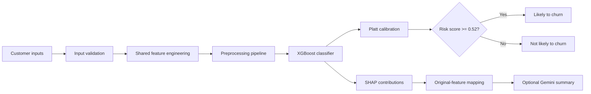

# Customer Churn Prediction System

[](https://github.com/KMD-Gouse/customer_churn/actions/workflows/ci.yml)


An end-to-end machine-learning application that estimates customer churn risk, applies probability calibration, explains individual predictions with SHAP, and optionally converts the explanation into a business-friendly summary using Gemini.

The notebook and Streamlit application share the same feature-engineering, calibration, configuration, threshold, and explanation logic. This prevents training and deployment behavior from drifting apart.

## Live demo

[](https://customer-churn1-predictor.streamlit.app/)

[Launch the Customer Churn Predictor](https://customer-churn1-predictor.streamlit.app/)

## Project highlights

- Trained an XGBoost classifier on 7,043 telecom customer records.
- Added three leakage-safe, row-level features: service count, automatic-payment indicator, and average monthly spend.
- Calibrated raw model scores using Platt scaling with logistic regression.
- Selected a decision threshold of **0.52** using validation-set calibrated risk scores and expected business value.
- Mapped 46 transformed SHAP features back to 21 understandable customer features.
- Added dependency-aware input validation and user-friendly artifact-loading errors.
- Added 16 automated unit and integration tests, including notebook-to-app score-parity tests.
- Added GitHub Actions continuous integration and a verified, non-root Docker deployment.
- Added an optional Gemini explanation layer without making the core prediction depend on an API key.

## Model performance

Metrics saved with the corrected model artifacts and evaluated on the held-out test set:

| Metric | Result |
|---|---:|
| ROC-AUC | **0.8327** |
| PR-AUC | **0.6280** |
| Precision at threshold | **0.6254** |
| Recall at threshold | **0.4733** |
| Decision threshold | **0.52** |

Dataset summary:

| Statistic | Value |
|---|---:|
| Customers | 7,043 |
| Churned customers | 1,869 |
| Churn rate | 26.54% |
| Model input features | 21 |
| Engineered features | 3 |
| Transformed SHAP features | 46 |

The application describes the calibrated output as a **risk score**. It is useful for prioritization and decision support, but it should not be interpreted as a guaranteed real-world probability or a causal conclusion.

## System architecture



The saved production bundle contains:

- `churn_pipeline.pkl`: preprocessing and XGBoost classification pipeline.
- `calibrator.pkl`: logistic-regression Platt calibrator.
- `config.json`: input schema, threshold, metrics, business assumptions, SHAP names, and original-feature mapping.
- `xgb_model.json`: portable XGBoost model export.

## Application capabilities

- Interactive customer profile entry in Streamlit.
- Validation of service dependencies and billing relationships.
- Calibrated churn-risk score and business decision threshold.
- SHAP waterfall visualization for each prediction.
- Increasing and reducing factors grouped by original business feature.
- Optional Gemini-generated business explanation and suggested actions.
- Graceful behavior when the Gemini key is absent.
- Clear recovery messages for missing, invalid, or incompatible artifacts.

## Repository structure

```text
customer_churn/
├── .github/workflows/ci.yml    # Automated CI checks
├── artifacts/                  # Corrected production model bundle
├── app.py                      # Streamlit user interface
├── app_support.py              # Validation and artifact-loading helpers
├── churn_utils.py              # Shared training and inference logic
├── llm_explainer.py            # Optional Gemini explanation layer
├── churn_final_corrected.ipynb # Training and evaluation notebook
├── test_*.py                   # Unit and integration tests
├── requirements.txt            # Local and Streamlit dependencies
├── requirements-dev.txt        # Development and test dependencies
├── requirements-docker.txt     # CPU-only Docker dependencies
├── Dockerfile                  # Production container definition
└── .dockerignore               # Docker build-context exclusions
```

## Run locally

### 1. Create and activate a Python 3.12 environment

Windows PowerShell:

```powershell
py -3.12 -m venv venv
.\venv\Scripts\Activate.ps1
```

macOS or Linux:

```bash
python3.12 -m venv venv
source venv/bin/activate
```

### 2. Install dependencies

For application development and testing:

```bash
python -m pip install --upgrade pip
python -m pip install -r requirements-dev.txt
```

### 3. Configure the optional Gemini integration

Create `.env` from `.env.example` and add your own key:

```text
GEMINI_API_KEY=your_gemini_api_key_here
```

Never commit `.env`. The churn prediction, calibration, validation, and SHAP explanation work without Gemini; only the optional AI-written summary requires the key.

### 4. Start Streamlit

```bash
streamlit run app.py
```

Open `http://localhost:8501`.

## Automated tests

Run the complete suite with:

```bash
python -m pytest -q
```

The 16 tests cover:

- Feature engineering, zero-tenure handling, and input immutability.
- Calibration output bounds and grouped SHAP explanations.
- Customer-input validation and cross-field dependencies.
- Missing or invalid artifact recovery messages.
- Artifact schema and model-dimension consistency.
- Exact notebook-to-application calibrated score parity.
- Streamlit startup, prediction output, and invalid-input blocking.

GitHub Actions runs the same suite on Python 3.12 for every push and pull request to `main`.

## Run with Docker

Build the CPU-only image:

```bash
docker build -t customer-churn:local .
```

Run without Gemini:

```bash
docker run --rm -p 8501:8501 customer-churn:local
```

Run with the optional Gemini key from the local `.env` file:

```bash
docker run --rm -p 8501:8501 --env-file .env customer-churn:local
```

The verified container:

- Runs as non-root user `appuser` with UID 10001.
- Exposes Streamlit on port 8501.
- Includes a health check at `/_stcore/health`.
- Uses `xgboost-cpu` to avoid unused GPU and NCCL dependencies.
- Copies only runtime code and the corrected artifacts into the image.

## Deploy on Streamlit Community Cloud

1. Open [Streamlit Community Cloud](https://share.streamlit.io/).
2. Select repository `KMD-Gouse/customer_churn`.
3. Select branch `main` and entrypoint `app.py`.
4. In **Advanced settings**, select Python 3.12.
5. Add the optional secret in TOML format:

   ```toml
   GEMINI_API_KEY = "your_real_key"
   ```

6. Deploy and copy the generated `streamlit.app` URL into the top of this README.

Community Cloud installs the root `requirements.txt`; the Docker-specific dependency file is used only when building the Docker image.

## Reproducibility and safeguards

- Training and inference call the same functions from `churn_utils.py`.
- The application loads one versioned artifact directory instead of duplicate root-level models.
- Artifact configuration is validated before predictions are enabled.
- The score-parity integration test detects notebook/application drift.
- `customerID` and `gender` are excluded from model inputs.
- Feature engineering uses only values from the current customer row.
- SMOTE was not used in the saved corrected model.
- API credentials and virtual environments are excluded from Git and Docker contexts.

## Business assumptions

The saved threshold optimization used these configurable assumptions:

| Assumption | Value |
|---|---:|
| Customer value | INR 2,500 |
| Retention-offer cost | INR 500 |
| Base save rate | 40% |

These are modeling assumptions rather than universal business facts. They should be replaced with organization-specific costs and observed retention outcomes before production use.

## Limitations and next improvements

- The data is a static telecom sample and may not represent a current customer population.
- Performance should be monitored for drift, calibration changes, and subgroup differences after deployment.
- SHAP explains model behavior for an individual prediction; it does not establish causation.
- Business recommendations generated by Gemini must be reviewed by a person.
- A future iteration can add SQL-based churn segmentation, experiment tracking, model monitoring, and scheduled retraining.

## Author

Developed by [KMD-Gouse](https://github.com/KMD-Gouse).
